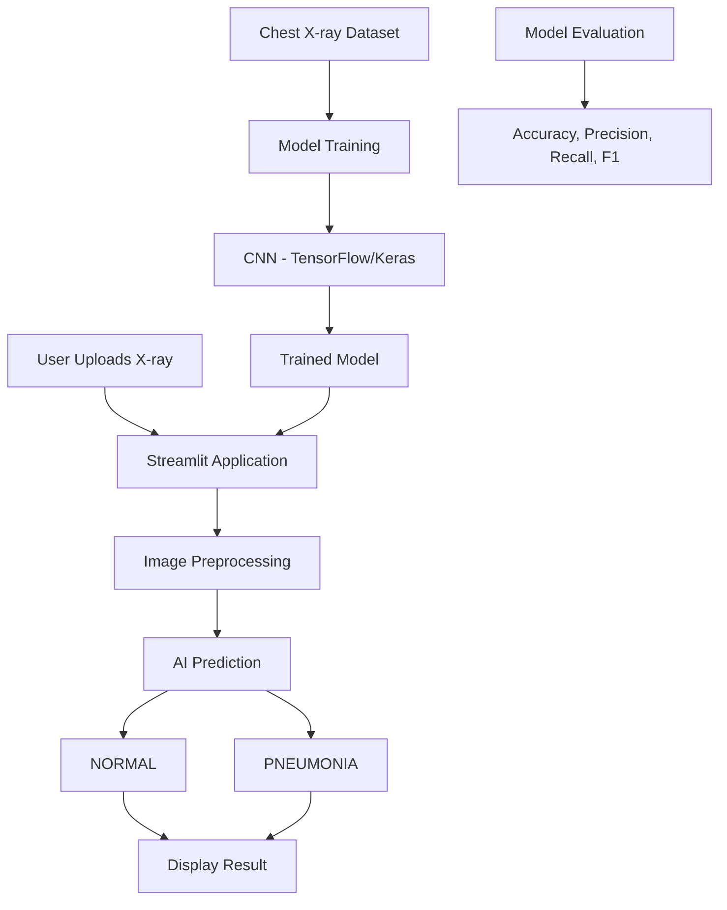

\# AI Medical Imaging – Pneumonia Detection


\## Project Overview

An AI-powered medical imaging application that analyzes chest X-ray images and predicts NORMAL or PNEUMONIA using a Convolutional Neural Network (CNN).


\## Technologies Used

\- Python

\- TensorFlow and Keras

\- Streamlit

\- NumPy

\- Pillow

\- CNN


\## Features

\- Upload chest X-ray images

\- AI-based pneumonia prediction

\- Display NORMAL or PNEUMONIA results

\- Show model confidence score

\- Interactive web application


\## Model Evaluation

Preliminary evaluation using 20 test images:

\- Accuracy: 80%

\- Precision: 80%

\- Recall: 80%

\- F1-score: 80%


\## How to Run


Install dependencies:


```bash

pip install -r requirements.txt

```


Run the application:


```bash

python -m streamlit run app.py

```


\## Disclaimer

This is an educational project prototype. It is not a medical diagnostic tool and must not be used for clinical decisions.

\## Architecture Diagram


## Architecture Diagram



## Application Screenshots

### Home Page


### Pneumonia Prediction


### Normal Prediction

